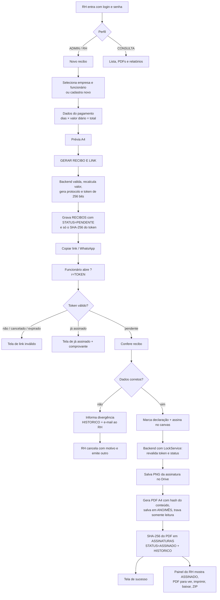
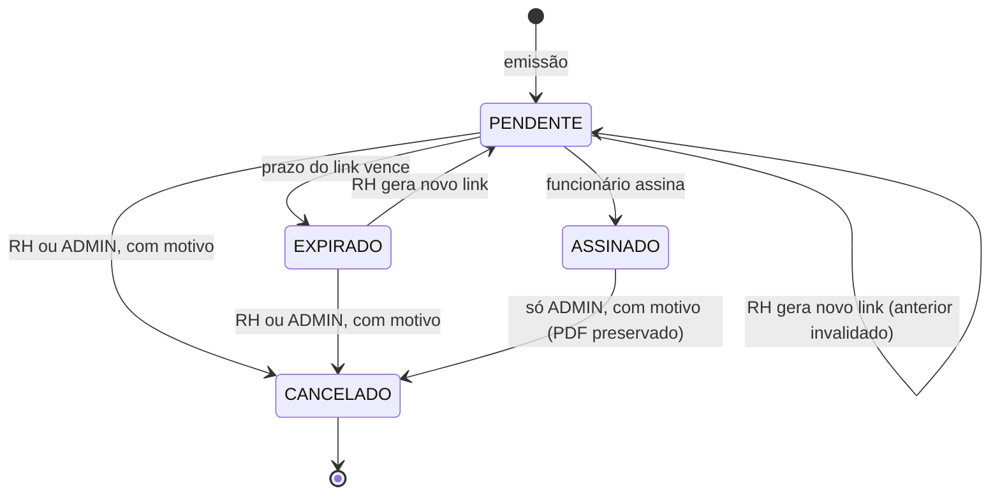

# Recibos Digitais — Vegas

Emissão, envio por WhatsApp, assinatura com o dedo e arquivo em PDF dos recibos de pagamento dos funcionários.
Frontend em GitHub Pages (HTML/CSS/JS puro) + backend Google Apps Script + Google Sheets (dados) + Google Drive (PDFs).

## Arquivos

| Arquivo | Onde vai |
|---|---|
| `index.html`, `style.css`, `script.js`, `assets/logo.jpg`, `assets/fundo.jpg` | Repositório GitHub `recibos` (GitHub Pages) |
| `Code.gs`, `Logo.gs`, `appsscript.json` | Projeto Apps Script vinculado à planilha |

`Logo.gs` contém a logo oficial (recortada do banner enviado) embutida em base64 para o PDF funcionar sem configuração extra.

## Fluxo do sistema

Regras de ciclo de vida:

## Permissões

| Ação | ADMIN | RH | CONSULTA |
|---|:-:|:-:|:-:|
| Ver painel, recibos, funcionários, relatórios | ✓ | ✓ | ✓ |
| Ver/baixar PDF, exportar ZIP e CSV | ✓ | ✓ | ✓ |
| Emitir recibo | ✓ | ✓ | |
| Gerar novo link / reenviar WhatsApp | ✓ | ✓ | |
| Cancelar recibo pendente/expirado | ✓ | ✓ | |
| Cancelar recibo assinado | ✓ | | |
| Cadastrar/editar funcionário | ✓ | ✓ | |
| Configurações, empresas, tipos de recibo | ✓ | | |
| Usuários e senhas | ✓ | | |

A checagem real acontece no backend (`PERMISSOES` em `Code.gs`); o frontend só esconde botões. O sistema impede ficar sem nenhum ADMIN ativo.

## Guia de estilo (seguir em qualquer alteração)

| Token | Valor | Uso |
|---|---|---|
| `--preto` | `#08090C` | fundo, cabeçalho do recibo |
| `--grafite` | `#171A20` | painéis, texto do recibo |
| `--metal` | `#737982` | rótulos secundários, status expirado |
| `--prata` | `#C7CBD1` | botões principais (gradiente metálico), títulos de bloco |
| `--branco` | `#FFFFFF` | texto de destaque, folha do recibo |
| `--azul` | `#168BFF` | ação primária, foco, faixa do recibo, gráficos |

Tipografia: Saira Semi Condensed (títulos, botões, números) e Barlow (texto). O recibo usa Arial, igual ao PDF.
Painéis: vidro (`--vidro` + blur 14px, borda prata 16%). Raios: 18px painéis, 10px caixas, 6px campos e botões.
Botões: prata = ação de apoio; azul = ação que gera ou confirma algo; fino = secundária; vermelho = cancelamento.
Status sempre com o mesmo selo e cor: pendente âmbar, assinado verde, expirado cinza, cancelado vermelho.
Logo: sempre o arquivo oficial `assets/logo.jpg` / `LOGO_PADRAO`. Não redesenhar.

## Instalação

### 1. Planilha e projeto
1. No Google Drive da conta do RH (a mesma que vai guardar os PDFs), crie uma planilha chamada `VEGAS_RH_RECIBOS`.
2. Na planilha: **Extensões → Apps Script**. O projeto já nasce vinculado, então não é preciso informar ID.
3. Se preferir um projeto independente, em **Configurações do projeto → Propriedades do script** crie `SHEET_ID` com o ID da planilha (trecho entre `/d/` e `/edit` da URL).

### 2. Código do backend
1. **Configurações do projeto** → marque “Mostrar arquivo de manifesto appsscript.json”.
2. Substitua o conteúdo de `appsscript.json` pelo arquivo enviado.
3. Crie os arquivos `Code.gs` e `Logo.gs` e cole o conteúdo.
4. Em **Serviços (+)**, confirme que “Drive API” v3 aparece com o identificador `Drive`. Ele trava os PDFs assinados como somente leitura; sem ele o sistema funciona, só não aplica a trava.

### 3. Inicializar
1. Selecione a função `setup` e clique em **Executar**. Autorize os acessos.
2. O `setup` cria as abas (FUNCIONARIOS, RECIBOS, ASSINATURAS, HISTORICO, CONFIGURACOES, EMPRESAS, USUARIOS), as 6 empresas do grupo (padrão: VEGAS SEGURANÇA E TECNOLOGIA PREVENTIVA LTDA, CNPJ 33.549.671/0001-65), os tipos de recibo e as pastas privadas `VEGAS_RH_RECIBOS_ASSINADOS` e `VEGAS_RH_ASSINATURAS`. As subpastas `2026/NOVEMBRO` são criadas sozinhas na primeira assinatura de cada mês.
3. Abra **Execuções** → último log e anote a senha do usuário `admin`. Troque no primeiro acesso.

### 4. Publicar o backend
1. **Implantar → Nova implantação → Tipo: App da Web**.
2. Executar como: **Eu**. Quem pode acessar: **Qualquer pessoa**. (Necessário para o funcionário abrir sem conta Google. A proteção é feita por token e sessão no próprio código.)
3. Copie a URL que termina em `/exec`.
4. A cada alteração no `Code.gs`: **Implantar → Gerenciar implantações → editar → Nova versão**. Assim a URL não muda.

### 5. Publicar o frontend
1. No GitHub (`vegasvig`), crie o repositório `recibos` e envie `index.html`, `style.css`, `script.js` e a pasta `assets`.
2. Em `script.js`, linha 3, troque `COLE_AQUI_A_URL_DO_APPS_SCRIPT/exec` pela URL do passo 4.
3. **Settings → Pages → Deploy from a branch → main / root**. A URL fica `https://vegasvig.github.io/recibos/`.
4. Entre no sistema → **Configurações** → confira “Endereço público do sistema” com essa URL (com `/` no final). É a base dos links enviados.

### 6. Permissões do Drive
As pastas são criadas privadas na conta que executou o `setup`. Não compartilhe a planilha nem as pastas com “qualquer pessoa com o link”. Para outro usuário do RH ver os arquivos direto no Drive, compartilhe a pasta só com o e-mail dele. O painel não depende disso: ele baixa o PDF pelo backend.

### 7. Testar
1. Cadastre um funcionário de teste com o seu próprio celular.
2. Emita um recibo de R$ 1,00, gere o link e envie pelo botão do WhatsApp.
3. Abra no celular (Android e iPhone): confira, toque em “Informar divergência” uma vez para testar o aviso, depois marque a declaração e assine.
4. No painel, o recibo deve aparecer como **Assinado**. Abra “Ver PDF”: assinatura no espaço reservado, data/hora do servidor, protocolo e hash.
5. No Drive: `VEGAS_RH_RECIBOS_ASSINADOS/2026/NOVEMBRO/VG2026-00001 - NOME - Tipo.pdf`.
6. Tente abrir o mesmo link de novo: deve mostrar “já está assinado”. Cancele um recibo de teste e confirme que o link para de funcionar.

### 8. WhatsApp
O botão usa `https://wa.me/55DDDNUMERO?text=...` com a mensagem padrão. Cadastre o celular com DDD (`(24) 99999-9999`). Sem celular, o WhatsApp abre para escolher o contato. Funciona com WhatsApp Web/Desktop no computador do RH e com o app no celular.

### 9. Problemas comuns
| Sintoma | Causa e correção |
|---|---|
| “Sem conexão com o servidor” | URL errada em `script.js`, implantação não é “Qualquer pessoa”, ou faltou criar nova versão após editar. |
| “Aba X não existe” | Rodar `setup` de novo (não apaga dados). |
| Link abre a página mas diz inválido | Foi gerado novo link depois (o anterior morre), recibo cancelado, ou `FRONTEND_URL` aponta para outro endereço. |
| “Sessão expirada” | Sessão dura 8 h. Entrar de novo. |
| PDF sem trava de somente leitura | Serviço avançado Drive API v3 não ativado (ver log em Execuções). |
| Muitas tentativas de login | Bloqueio de 15 min após 5 erros no mesmo usuário. |
| Logo diferente no PDF de outra empresa | Em Configurações → Empresas, informe o ID do arquivo da logo dessa empresa no Drive. |

## Decisões técnicas que importam

- **O link não fica salvo.** A planilha guarda só o SHA-256 do token. Quem tiver acesso à planilha não consegue montar links. Consequência: para reenviar, o RH usa “Novo link”, que invalida o anterior. Isso é intencional.
- **O valor é recalculado no servidor** (dias × diário). O navegador não decide o valor final.
- **Snapshot da empresa:** os dados da empresa são copiados para o recibo na emissão. Alterar endereço depois não muda recibos já emitidos.
- **Imutabilidade:** o PDF assinado nunca é regerado; downloads e ZIP entregam o arquivo original. Duas provas de integridade: hash do conteúdo + assinatura impresso no PDF, e SHA-256 do arquivo PDF na aba ASSINATURAS.
- **Minimização (LGPD):** na página do funcionário o CPF aparece mascarado (se o link vazar, não expõe o CPF completo). O PDF arquivado tem o CPF completo.
- **Fórmula injetada:** textos começando com `= + - @` são gravados como texto na planilha e no CSV.

## Pontos de atenção

- **Validade jurídica.** É assinatura eletrônica simples, não ICP-Brasil. A MP 2.200-2/2001 (art. 10, §2º) admite outros meios de comprovar autoria quando aceitos pelas partes. Recomendo um termo de adesão assinado pelo funcionário (pode ser na admissão) concordando em receber e assinar recibos por meio eletrônico. Validar com o jurídico antes de abandonar o papel.
- **Usuário desativado** perde acesso no próximo login; uma sessão já aberta dura até 8 h.
- **Cotas do Google:** e-mail de divergência usa a cota diária do MailApp (100/dia em conta gratuita, 1.500 em Workspace). A geração do PDF leva de 3 a 8 s por assinatura.
- **Volume:** a lista carrega todos os recibos de uma vez. Confortável até alguns milhares de linhas; acima disso, arquivar o ano anterior em outra aba.
- **Repositório público:** o GitHub Pages gratuito exige repositório público. Não há segredo no frontend; toda validação está no Apps Script.

---
Vegas Vigilância e Segurança
